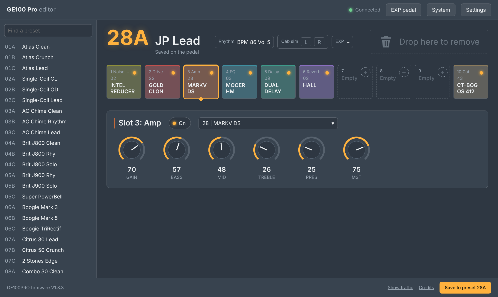
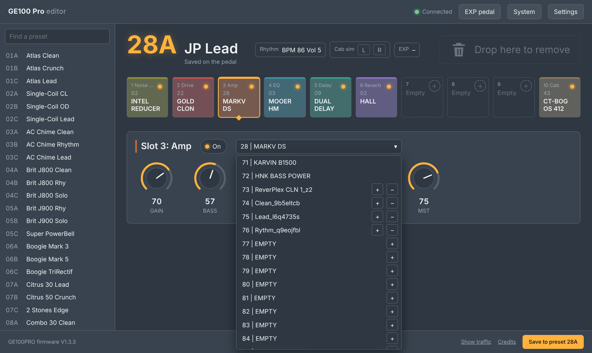
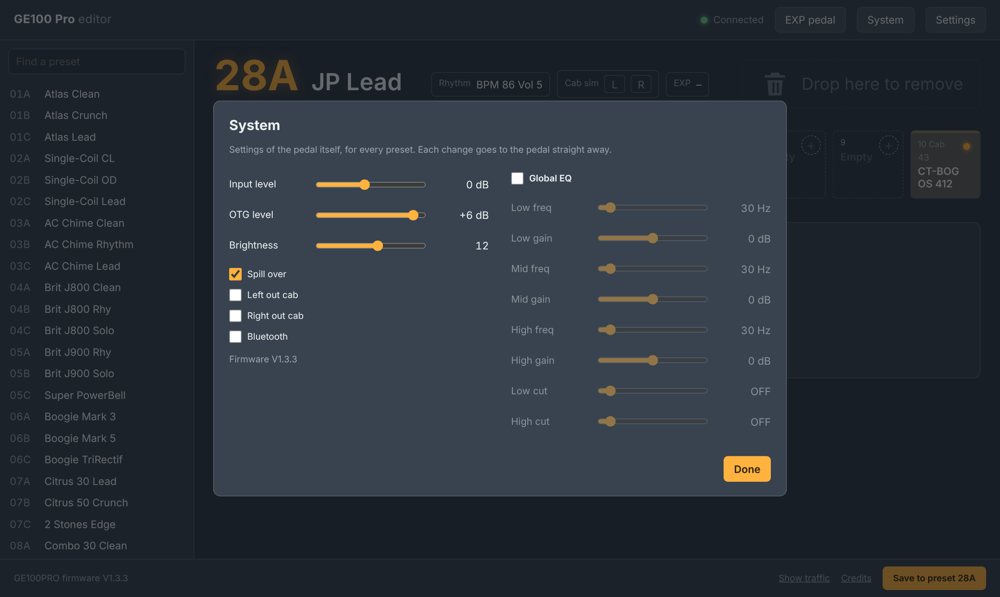
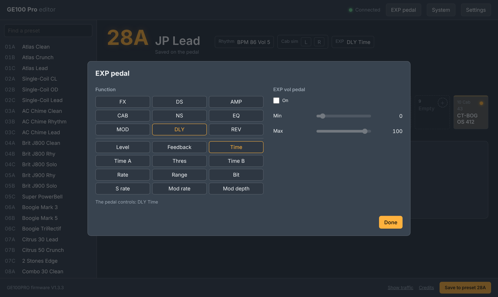

# mooer-ge100pro

An unofficial **editor for the Mooer GE100 Pro / GE100 Pro Li** multi-effects pedal, plus the reverse-engineered USB
protocol it is built on. It runs in Chrome, Edge or Brave (WebHID) on Windows 11, or as a standalone Windows program,
and also works on a Raspberry Pi.

Unofficial: not affiliated with or endorsed by Mooer. Close Mooer Studio while you use it: only one program can talk to
the pedal at a time.



## What the editor does

- **Presets**: all 150 presets as on the pedal (01A … 50C), with search; switching asks to save unsaved changes.
- **The chain**: the 10 blocks with their model and on/off LED, coloured per effect group. Drag a block to move it,
  drop it on the bin to remove it, click **+** on an empty slot to add one.
- **Knobs**: every model with its real knob names, ranges and units (dB, ms, Hz, sub-divisions), changed live on the
  pedal while you turn them.
- **Models**: a point-and-click list per block with the pedal's own numbering and names (`28 | MARKV DS`).
- **Your own captures and IRs**: load NAM amp captures (as .gnr) and cab IRs (.wav) into the user slots with **+**,
  replace or delete them with **+** / **−**, and use them in a preset.
- **Save** to the current preset or any other one, with its name.
- **System**: input and OTG level, brightness, global EQ, spill over, cab sim left/right, Bluetooth.
- **EXP pedal**: which block and parameter the expression pedal controls; the EXP volume pedal with min and max.
- **Header**: rhythm BPM and volume, cab sim L/R switches, the EXP assignment.
- **Settings**: text sizes and colours for every part, a colour per effect group, saved to `settings.js`.
- **Traffic panel**: every message to and from the pedal in hex, for curious people and for debugging.



| System settings | EXP pedal |
|---|---|
|  |  |

## Getting started

**In the browser (Windows, Linux):** clone the repository (branch `GE100_MOD`), connect the pedal's **data** USB-C
port, and open `web/index.html` in Chrome, Edge or Brave. Click **Connect** once and pick the GE100 Pro; after that the
editor connects by itself.

```powershell
git clone -b GE100_MOD https://github.com/maarthome/mooer-ge100pro.git
```

**As a Windows program:** build `GE100Pro_Editor.exe` once (needs Python 3.9+; see
[Building the executables](docs/Building%20the%20executables.docx)):

```powershell
powershell -ExecutionPolicy Bypass -File tools\build_editor_exe.ps1
```

**From the code, also on a Raspberry Pi** (opens Chromium; on Linux first install the udev rule below):

```bash
PYTHONPATH=src python3 -m ge100pro.app
```

**NAM captures** have to be converted to .gnr first, with Mooer's own converter that comes with Mooer Studio:
`tools/nam_to_gnr.py` (or `NAM_to_GNR.exe`) does that for one file or a whole folder, see
[How to convert NAM to GNR](docs/How%20to%20convert%20NAM%20to%20GNR.docx).

More about the editor: [web/README.md](web/README.md).

## Documentation

| Document | Contents |
|---|---|
| [How to convert NAM to GNR](docs/How%20to%20convert%20NAM%20to%20GNR.docx) | converting captures and loading them into the pedal |
| [Building the executables](docs/Building%20the%20executables.docx) | building the two .exe files and which files they need |
| [GE100 Pro editor: code and protocol](docs/GE100%20Pro%20editor%20-%20code%20and%20protocol.docx) | how the code is built, how to develop it, the USB protocol in hex |
| [PROTOCOL.md](PROTOCOL.md) | the detailed protocol notes, with what is verified and what is a guess |

## The protocol in short

USB HID `34db:0011`, 64-byte reports; frames `AA 55 | length | command | payload | CRC-16/GSM`; a reply's command is
the request's + 1 (the Mooer Prime M2 command family). Everything was found by recording Mooer Studio with Wireshark
and USBPcap and decoding the recordings; commands are only sent once they have been seen from Mooer Studio, because
guessed ones can lock the pedal up. Details: [PROTOCOL.md](PROTOCOL.md).

## Python tools

The Python package in `src/ge100pro` decodes the pedal's messages live on Linux (developed on a Raspberry Pi 5) and
reads Wireshark/USBPcap recordings; it also powers the desktop app.

## Quick start (Linux)

Connect the pedal's **data** USB-C port. Allow access without root (members of `plugdev`, also over SSH):

```bash
sudo cp udev/70-mooer-ge100pro.rules /etc/udev/rules.d/
```

```bash
sudo udevadm control --reload-rules && sudo udevadm trigger
```

Check that `/dev/hidrawN` now belongs to `plugdev` and that you are a member:

```bash
ls -l /dev/hidraw* && groups
```

If `plugdev` is missing from `groups`, add yourself and open a new login session:

```bash
sudo usermod -aG plugdev "$USER"
```

Run the live decoder from the repo folder (no install needed), then use the pedal:

```bash
PYTHONPATH=src python3 -m ge100pro
```

Read the pedal's state, all 150 preset names and the current preset, using only the read requests Mooer Studio uses
(close Mooer Studio first):

```bash
PYTHONPATH=src python3 -m ge100pro.probe
```

Decode a filtered Wireshark capture, both directions (see [captures/README.md](captures/README.md), raw captures also
contain your keyboard):

```bash
PYTHONPATH=src python3 -m ge100pro tests/fixtures/01_connect_ge100pro.pcapng
```

Decode a saved `xxd -c 64` dump of `/dev/hidrawN`:

```bash
PYTHONPATH=src python3 -m ge100pro tests/fixtures/capture1_xxd.txt
```

Or install it in a virtual environment, which also gives the `ge100pro-decode` command:

```bash
python3 -m venv .venv && .venv/bin/pip install -e .
```

## Quick start (Windows 11)

Needs Python 3.10 or newer (nothing else: the Windows HID access uses only the standard library). In PowerShell:

```bash
winget install Python.Python.3.13 Git.Git
```

Open a new PowerShell window, then:

```bash
cd $HOME; git clone -b GE100_MOD https://github.com/maarthome/mooer-ge100pro.git; cd mooer-ge100pro
```

```bash
$env:PYTHONPATH = "src"
```

**Close Mooer Studio first**: only one program can use the pedal's control channel. Then watch the pedal live, or ask
it for its state, names and current preset (read-only):

```bash
python -m ge100pro
```

```bash
python -m ge100pro.probe
```

Decoding and filtering captures works the same as on Linux, for example:

```bash
python -m ge100pro tests/fixtures/02_select_preset.pcapng
```

## Tests

The tests check the decoder against real GE100 Pro traffic in `tests/fixtures/`:

```bash
PYTHONPATH=src python3 -m pytest -q
```

## Layout

| Path | Contents |
|---|---|
| `src/ge100pro/crc.py` | CRC-16/GSM (from fingerskier/Mooer_GE150_Pro_Li-IO) |
| `src/ge100pro/framing.py` | `AA 55` frames, 64-byte report splitting, stream reassembly (adapted from the same project) |
| `src/ge100pro/messages.py` | decoders for the pedal's messages |
| `src/ge100pro/transport.py` | connection (Linux hidraw, Windows hid.dll); sends only confirmed read requests |
| `src/ge100pro/hid_win.py` | Windows HID access, stdlib ctypes (from atahan26/ge200-editor) |
| `src/ge100pro/decode.py` | live / xxd / pcapng decoder (`python3 -m ge100pro`) |
| `src/ge100pro/pcapng.py` | USBPcap capture reader and filter (`python3 -m ge100pro.pcapng filter IN OUT`) |
| `src/ge100pro/probe.py` | read-only state/names/preset query (`python3 -m ge100pro.probe`) |
| `captures/` | raw captures still being analysed |
| `tests/fixtures/` | captures that back a verified fact |
| `udev/` | udev rule |
| `web/` | the web editor (`index.html`, `protocol.js`) |

## Credits

See [CREDITS.md](CREDITS.md) for every project this work builds on. In short: `crc.py` and `framing.py` come from [fingerskier/Mooer_GE150_Pro_Li-IO](https://github.com/fingerskier/Mooer_GE150_Pro_Li-IO),
`hid_win.py` from [atahan26/ge200-editor](https://github.com/atahan26/ge200-editor) (both MIT, see [NOTICE.md](NOTICE.md)). The protocol work builds on the published findings of the Mooer projects listed in
[PROTOCOL.md §6](PROTOCOL.md#6-related-projects), in particular the Prime M2 research by andymann.

## License

MIT, see [LICENSE](LICENSE).
